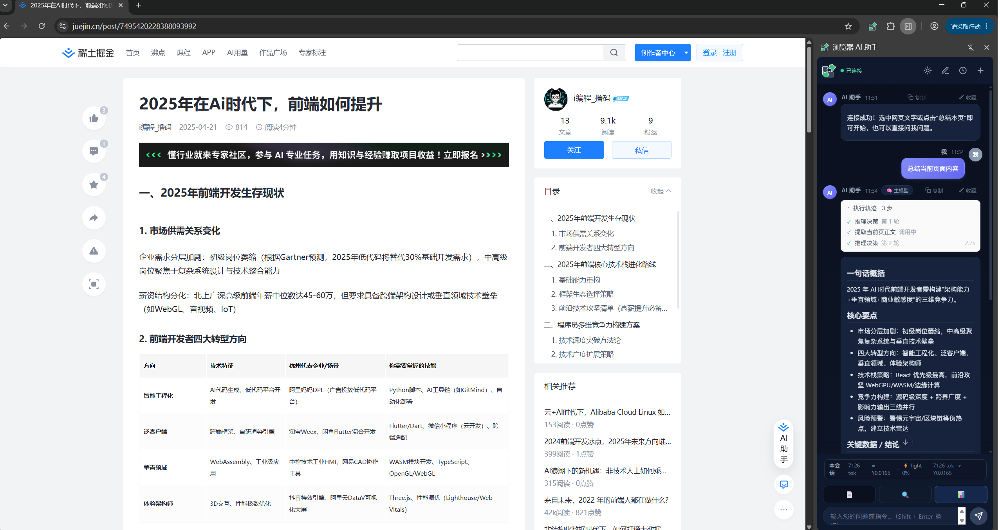
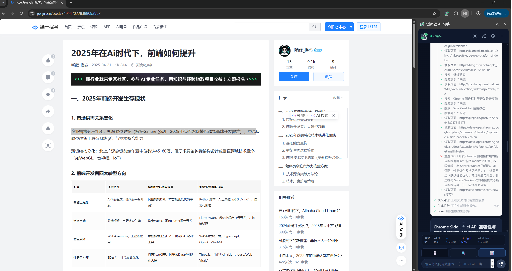
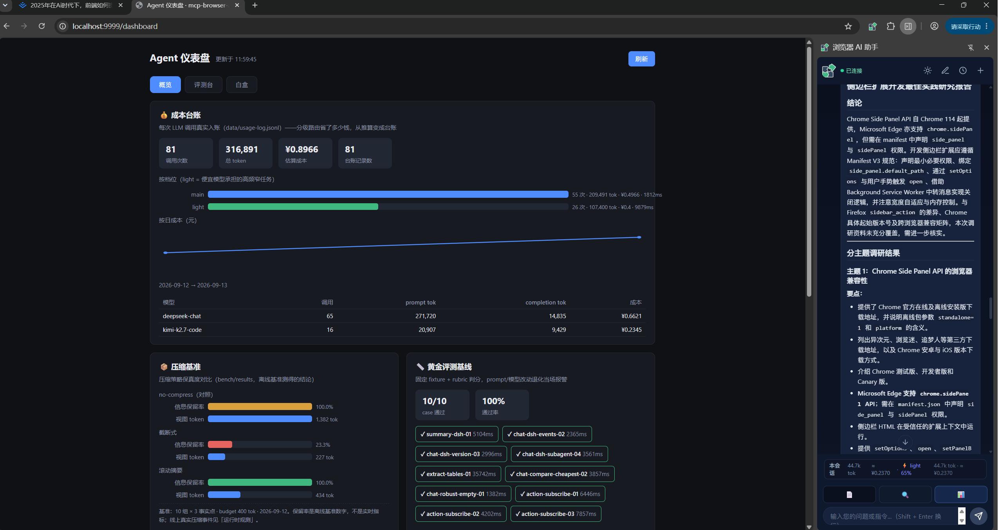
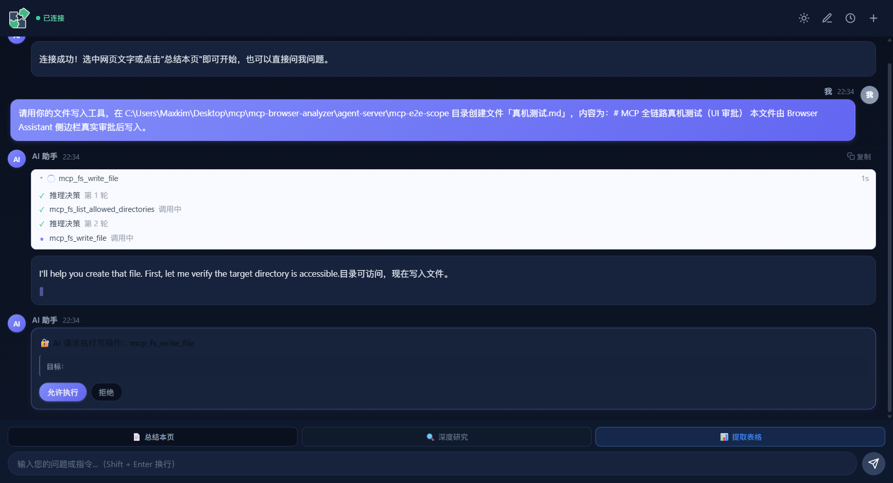
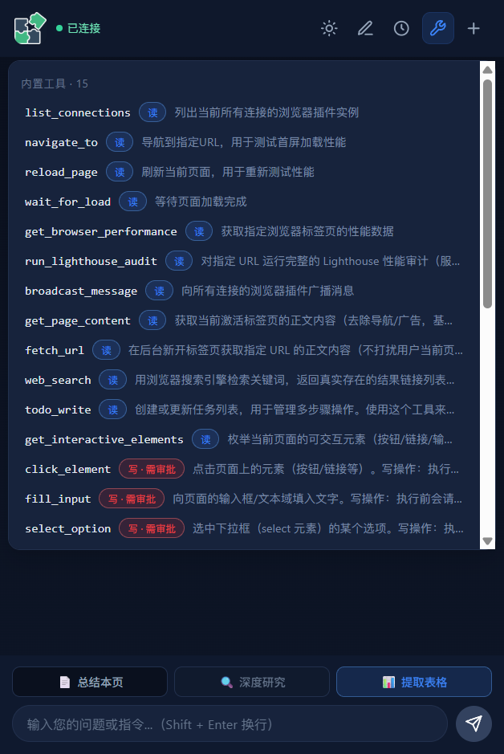
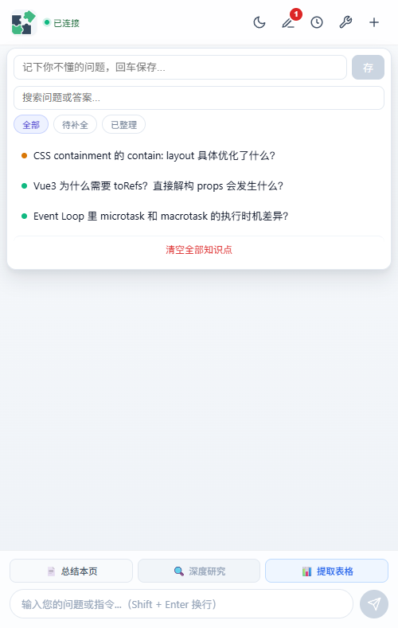
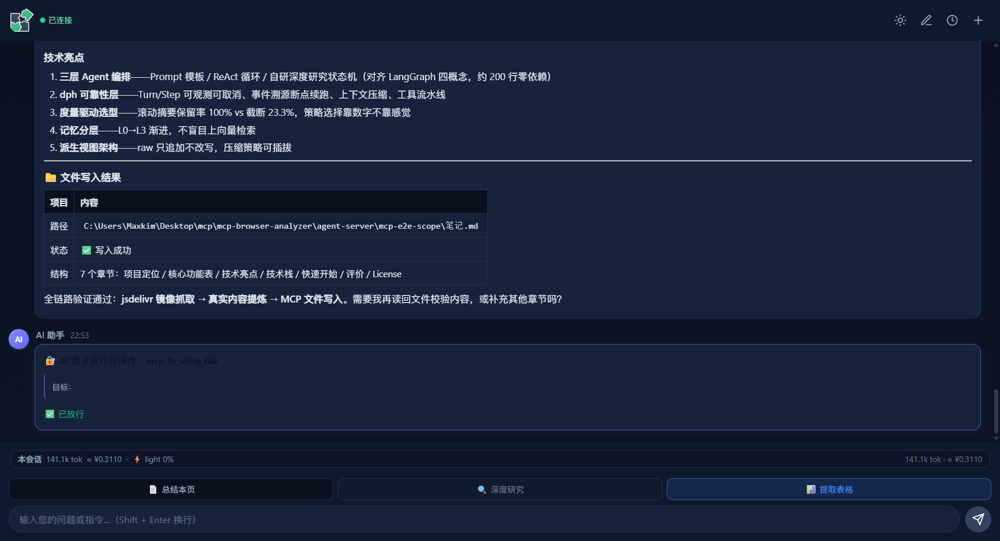

<div align="center">

# 浏览器 AI 助手 · Browser AI Assistant

一个住在浏览器**侧边栏**里的 AI 助手：不切页面，就能总结网页、划词即问、围绕页面内容追问，甚至自动完成一次带来源的**深度研究**。内置**AI 代码审查**能力，可通过 GitHub Actions 自动对 PR 生成行级评论。

Chrome Extension（Vue3 + MV3） · Node.js Agent Server（DeepSeek + 自研 Agent 编排） · **MCP 宿主（自研 Client）** · AI Code Review CLI

</div>

---

## 🎬 效果先睹为快

**一键总结本页**——概括 / 要点 / 关键数据结构化输出，标注来源 URL，右下角还有本次调用的 token 与成本：



**深度研究**——自动检索真实链接、后台逐页静默阅读、交叉对比后输出带来源与可信度标注的报告，执行轨迹全程可见：



**质量度量上屏**——成本台账、压缩保真度基准、黄金评测基线、记忆 A/B 全部可视化（`localhost:9999/dashboard`）：



**MCP 外部工具接入**——自研 MCP Client 接入官方 filesystem server，LLM 自主调用 `mcp_fs_write_file`，写操作触发审批卡片：



**能力工具箱**——AI 背后有什么能力一点即见：内置工具 + MCP server 分组展示，每个工具带读/写定级徽章（写·需审批）；清单是运行时注册表快照，接了什么显示什么：



**知识点卡片库**——秋招随手记：划词/手输/AI 回答一键收藏，列表/详情两态 + 搜索筛选；pending 卡在详情态显式触发「AI 补全」（专用提示词 + 工具硬闸），骨架屏过渡、失败可重试、删除 5 秒内可撤销：



**AI 操作可视化 + ref 精准寻址**——写操作执行时科幻光标缓动移动、点击出涟漪、"AI 正在操作"实时指示；元素用引用身份寻址（WeakRef+指纹，执行前校验），shadow DOM 穿透枚举，失效即报错绝不误点：


**实用任务闭环**——"总结当前页面，把要点存成笔记"：真实读取页面 → LLM 结构化总结 → MCP 审批落盘 → 记忆引用标签全程可见：



---

## ✨ 功能特性

| 分类 | 功能 | 说明 |
| --- | --- | --- |
| **核心交互** | 📄 一键总结本页 | Readability 提取正文 + 结构化 Prompt 模板 → 输出概括/要点/结论，标注来源 URL，回答可溯源 |
| | ✍️ 划词即问 | 选中文字弹出浮动工具条（翻译/解释/改写/总结/自由提问），Shadow DOM 隔离页面样式 |
| | 💬 多轮上下文对话 | 会话持久化（`chrome.storage.local` 分桶存储），历史会话可切换 |
| | ⚡ 流式输出 | SSE 增量解析 + WebSocket 分片推送，打字机效果；工具调用与文本输出同通道区分 |
| **深度研究** | 🔍 Deep Research | 自动规划子问题 → 后台静默多页读取 → 信息充分性评估 → 交叉对比 → 流式生成带来源报告；checkpoint 断点恢复；**分级 HITL**——正常路径全程连跑零打断，只在死胡同/预算告警时请求人工拍板（`hitlMode: on-deadend / every-topic / off`），可选计划确认（planReview）把方向调整前置到研究开始前 |
| **页面操作** | 🖱️ 写操作 + 分级权限审批 | Agent 可点击/填表/选下拉（`click_element`/`fill_input`/`select_option`）：读操作零打断，**每次写操作前推送审批卡片**（展示目标描述与 ref 徽章），超时/断连默认拒绝；写动作预算封顶（默认 8 个/轮）+ dry-run 模式 + 审批/执行全链路审计落痕（含 ref 归因）；**P12a ref 引用身份寻址**——元素枚举发 ref（WeakRef+指纹），执行前校验身份、失效即报错（页面变了绝不静默点错），actionability 矩阵（可见/两帧稳定/遮挡命中/enabled）+ 动作后校验（页面有响应/无变化回喂自诊）；**fill_form 批量填表**（两阶段执行：先全量预检再逐字段落笔，审批一次看全部字段、逐字段 before→after）+ **wait_for 等待异步结果**；shadow DOM 穿透枚举 + 伪 HTML 快照 + 操作可视化动画（科幻光标/涟漪/执行指示）；真实站点 e2e（httpbin 表单提交闭环 / bing 搜索结果等待） |
| **模型路由** | 🎚️ 分级路由 + 多模型抽象 | Provider 适配层（当前 OpenAI 兼容协议，可扩展 Claude/Gemini）与模型选择解耦；调用点按任务标注 tier——grade 打分/检索词改写/上下文压缩走 light 便宜模型，plan/报告走 reasoning 档，未配置档位自动回落主模型；瞬时错误（限流/5xx/网络）自动指数退避重试 |
| **可靠性** | 🛑 可取消回答 | AbortController 支持随时停止生成，不浪费 token |
| | 📊 Step 级可观测 | 推理/工具执行进度实时下发前端，用户可看到 Agent 当前在做什么；工具调用有**终态**（完成/被拒/预演/出错 + 耗时），轨迹不再停在"调用中" |
| | 📝 事件溯源 | append-only JSONL 事件日志，服务重启自动投影重建上下文（断点续跑） |
| | 📦 上下文压缩 | token 预算 + 冷热分层滚动摘要，长会话不爆 context window；**派生视图架构**——raw 只追加不改写，压缩策略可插拔（rolling-summary/truncate/no-compress），tool_calls 消息组原子性有边界对齐保障 |
| **度量** | 📏 上下文压缩基准 | 自建保真度基准（埋事实点→压缩→考回）实测：滚动摘要保留率 **100%**、截断式仅 **23.3%**，视图 token 省 69%——策略选型靠数字不靠感觉 |
| | 📋 黄金评测集 | 固定 fixture + rubric 三层判分（字符串/正则/LLM-as-judge），`pnpm eval` 自动阅卷出成绩单，prompt/模型改动退化当场报警；**写操作轨迹判卷**——期望动作序列按相对顺序比对（工具/选择器/值），评测离线可复现 |
| | 🖥️ 评测台 + 白盒仪表盘 | `localhost:9999/dashboard` 三视图：**概览**（成本台账/压缩基准/评测基线/记忆 A-B/观测事件）+ **评测台**（测试集可浏览、逐 case 判卷明细、历史通过率趋势）+ **白盒飞行记录仪**（会话事件时间线逐条展开原始 JSON、进程观测流实时轮询） |
| | 💰 Token 成本账本 | 每次 LLM 调用（含 tier）落 JSONL 台账，`pnpm report` 按档位/模型汇总成本——分级路由的 ROI 有账可查 |
| | ⏱️ 工具流水线 | 统一权限校验 + 超时控制，为写操作审批预留挂载点 |
| **个性化** | 🎯 偏好记忆（L3） | 跨会话记住总结风格/翻译语言/回复风格，自动注入提示词 |
| | 🗂️ 知识点卡片库 | 划词「记笔记」/ 手输 / AI 回答一键收藏；列表/详情两态 + 搜索 + 状态筛选；pending 卡**显式触发 AI 补全**（专用 `knowledge_complete` 提示词 + 工具硬闸，不携带 15 工具 schema）+ 骨架屏 + 失败可重试 + 90s 超时兜底；删除/清空 5 秒撤销 |
| | 🧠 浏览记忆 RAG（L4 混合检索） | 总结过的页面自动沉淀为记忆卡片（本地 JSONL 只追加），提问时**混合检索**——BM25（CJK 双字组）+ embedding（方舟 2048 维）双路召回 RRF 融合——top-3 注入上下文，回答自动带"📌 参考了你之前读过的 N 篇"引用标签；三路对照实测：关键词集 100% 不回退、语义对抗集 40%→**100%**（**置信度门控**——词法名次需语义背书，修复词面陷阱卡污染等权 RRF 的偏差，含留出验证防过拟合）；向量通道失败自动降级 BM25 并打 degraded 标记，auto 模式未配向量时与纯 BM25 行为一致 |
| | 📚 文章收藏 | 收藏已总结的文章，支持回看检索 |
| **外部工具生态** | 🔌 MCP Client（自研） | stdio + JSON-RPC 2.0，兼容 2026-07-28 stateless 与存量握手两代规范；官方 filesystem server 一键接入 14 个工具；**注册期治理三道闸**——工具描述注入扫描（对抗 tool poisoning 注册期攻击，命中拒绝并留痕）→ dangerLevel 自动定级（分不了级默认按写操作走人审）→ 调用统一走审批/超时/事件溯源管线 |
| | 🧰 能力可见性（工具箱面板） | 侧边栏一键查看 AI 背后的能力清单：内置工具 + MCP server 分组、读/写定级徽章、server 存活态——**运行时注册表快照驱动**（WS 按需拉取 + 注册完成主动广播），接了什么显示什么；空态推荐词按工具能力特征匹配（有写文件类工具才推荐"存桌面笔记"），不硬编码承诺不存在的能力 |
| **额外工具** | 📊 页面性能分析 | 双通道：插件采集 LCP 等实时指标 + 服务端 Lighthouse 完整审计（四类得分/核心指标/优化机会） |
| **🔧 AI 代码审查** | 💻 ai-code-review | 零依赖 CLI + GitHub Actions 自动触发，对 PR/MR 生成行级评论（安全漏洞/圈复杂度/命名规范），支持适配器模式扩展平台 |

## 🏗️ 架构

```
┌──────────────────────────── Chrome 扩展（Vue3 + MV3）────────────────────────────┐
│  SidePanel 侧边栏  ◀───▶  Background Service Worker  ◀───▶  Content Script        │
│  （对话 UI / 深度研究）     （消息路由 / 手势 API / 后台抓页）   （Readability + 划词工具条） │
│  ┌────────────────────────────────────────────────────────────────────────────┐   │
│  │  F5 偏好记忆 · F4 会话持久化（chrome.storage.local）                       │   │
│  └────────────────────────────────────────────────────────────────────────────┘   │
└────────────────────────────────────┬──────────────────────────────────────────────┘
                                     │ WebSocket（:9999，requestId 异步匹配）
┌────────────────────────────────────▼──────────────────────────────────────────────┐
│                              Agent Server（Node.js）                              │
│  ┌────────────────────────────────────────────────────────────────────────────┐   │
│  │                    三层 Agent 编排（按任务复杂度选型）                        │   │
│  │  Prompt 模板（固定任务） │ ReAct 循环（开放对话） │ 深度研究状态机（plan→    │   │
│  │  · 总结/翻译/改写        │ · 模型选工具→执行→回喂 │ research→compare→report） │   │
│  └────────────────────────────────────────────────────────────────────────────┘   │
│  ┌────────────────────────────────────────────────────────────────────────────┐   │
│  │  dph 可靠性增强层（对标 DeepSeek Harness 2026）                            │   │
│  │  · dph-A: Turn/Step 执行模型（可观测 + AbortController 取消）               │   │
│  │  · dph-B: 事件溯源日志（append-only，断点续跑）                             │   │
│  │  · dph-C: 上下文压缩（token 预算 + 冷热分层滚动摘要）                        │   │
│  │  · dph-D: 工具执行流水线（权限/超时统一 hook，写操作审批预留）               │   │
│  └────────────────────────────────────────────────────────────────────────────┘   │
│  LLM 客户端（SSE 流式解析 + Function Calling） · 工具封装（schema/handler/传输）   │
└────────────────────────────────────┬──────────────────────────────────────────────┘
                                     │ OpenAI 兼容接口
                              ┌──────▼──────┐
                              │  DeepSeek   │
                              └─────────────┘
```

### 关键设计决策

- **三层编排**：固定任务用 Prompt 模板保证结构化输出；开放对话走 ReAct 循环灵活调用工具；深度研究用自研状态机（对齐 LangGraph 四概念：State/节点/条件边/checkpoint/HITL），~200 行零依赖可单测
- **记忆分层 + 混合检索**：L0 当前上下文 → L1 会话历史 → L2 滚动摘要 → L3 偏好 KV → L4 浏览记忆卡片；卡片检索用 BM25 + embedding 双路 RRF 融合（只用名次免疫量纲），向量通道失败自动降级 BM25——两个场景都不塌方
- **MCP 宿主治理**：接入即纳管——注册期注入扫描（tool poisoning 是注册期攻击面，描述是元数据无误报代价）→ dangerLevel 自动定级（分不了级默认按写操作走人审）→ 复用审批/超时/事件溯源管线；协议"先探测、被拒再握手"，兼容 2026-07-28 stateless 与存量两代规范
- **ai-code-review 适配器模式**：核心审查逻辑与平台解耦，Mock/GitHub/GitLab 三种适配器可插拔
- **Skills 可插拔**：安全审查/复杂度检查/命名规范各成模块，precheck（确定性扫描）+ LLM 审查双层保障

## 🚀 快速开始

### 环境要求

- Node.js >= 20
- pnpm >= 9

### 1. 安装依赖

```bash
pnpm install
```

### 2. 配置 Agent Server

在 `agent-server` 目录下创建 `.env`：

```bash
cd agent-server
```

```env
ARK_API_KEY=你的DeepSeek API密钥
ARK_BASE_URL=https://api.deepseek.com
ARK_MODEL=deepseek-chat
```

可选：配置轻量档模型（分级路由用——打分/检索词改写/上下文压缩走 light 档省钱，不配置则自动回落主模型）：

```env
LLM_LIGHT_MODEL=kimi-k2.7-code
LLM_LIGHT_BASE_URL=你的OpenAI兼容接口地址
LLM_LIGHT_API_KEY=对应密钥
```

可选：记忆混合检索的向量通道（方舟 doubao-embedding-vision，2048 维；不配置则纯 BM25，行为完全一致）：

```env
EMBED_BASE_URL=https://ark.cn-beijing.volces.com/api/coding/v3
EMBED_API_KEY=你的方舟密钥
EMBED_MODEL=doubao-embedding-vision
```

可选：接入第三方 MCP server（JSON 数组，可多个并存；未配置不启动）：

```env
MCP_SERVERS=[{"name":"fs","command":"npx","shell":true,"args":["-y","@modelcontextprotocol/server-filesystem","D:/你的笔记目录"]}]
```

接入即纳管：工具自动过注册期注入扫描与 dangerLevel 定级，写操作走审批卡。更多 server（GitHub/Playwright/SQLite/Notion）的接入测试方法见仓库根 `TODO.md`。

### 3. 启动 Agent Server（监听 :9999）

```bash
pnpm agent-server
```

或进入 `agent-server` 目录直接 `npm start`。

### 4. 构建并加载 Chrome 插件

```bash
pnpm extension:build   # 一次性构建插件（产物在 chrome-extension/extension/dist）
pnpm extension         # watch 模式，改代码自动重构建
```

1. 打开 Chrome，访问 `chrome://extensions/`
2. 开启右上角「开发者模式」
3. 点击「加载已解压的扩展程序」，选择 `chrome-extension/extension` 目录（即 `manifest.json` 所在层）
4. 点击扩展图标 → 打开侧边栏，即可开始使用

### 5. 测试与质量保障

```bash
pnpm test             # 158 个单测（node:test 零依赖），锁编排层行为不变量
pnpm eval             # 黄金评测集：10 个 case 端到端阅卷出成绩单（离线可复现）
pnpm eval:memory      # 浏览记忆 A/B 对照：recall@3 / 记忆增益 Δ
pnpm eval:hybrid      # 混合检索三路对照：BM25/向量/hybrid 的 recall@3（确定性判分，零 LLM 成本）
pnpm embed:sync       # 存量记忆卡片向量回填（幂等，需 EMBED_* 配置）
pnpm bench            # 压缩保真度基准：滚动摘要 vs 截断 vs 不压缩
pnpm report           # Token 成本账本：按档位/模型汇总分级路由 ROI
pnpm mcp:demo         # MCP 官方 filesystem server 注册演示（三道闸可见）
pnpm mcp:e2e          # MCP 全真集成测试：真 LLM + 真 server + 真磁盘断言
```

评测与基准的产物落盘在 `agent-server/eval/results` 与 `agent-server/bench/results`；仪表盘 `localhost:9999/dashboard` 只读这些产物展示（dashboard 不生产数字，只呈现数字）。

---

## 💻 AI Code Review（独立 CLI）

零依赖 Node.js CLI，可通过 GitHub Actions 自动在 PR 上生成行级评论：

- **安全审查**：SQL 注入、硬编码密钥、危险函数调用（eval/exec）等
- **复杂度检查**：圈复杂度过高提示拆分
- **命名规范**：变量/函数命名问题
- **适配器模式**：支持 GitHub（行级评论）、GitLab（MR 讨论）、Mock（终端打印）

### 手动使用

```bash
cd ai-code-review
node bin/ai-cr.mjs --platform github --repo <owner>/<repo> --pr <number> --post
```

### GitHub Actions 自动触发

已配置 `.github/workflows/ai-cr.yml`，PR 创建/更新时自动执行审查并回贴评论。需在仓库 Secrets 配置：
- `GITHUB_TOKEN`：带 Pull requests: Read and write 和 Contents: Read and write 权限
- `ARK_API_KEY`：DeepSeek API 密钥

Mock 演示：
```bash
cd ai-code-review
npm run review:sample
```

详见 [ai-code-review/README.md](ai-code-review/README.md)。

## 🛠️ 技术栈

| 分类 | 技术 |
| --- | --- |
| 浏览器扩展 | Chrome Extension MV3 · SidePanel · Service Worker · Content Script（Isolated World） |
| 前端 UI | Vue 3 + Vite |
| 正文提取 | @mozilla/readability（失败降级 body.innerText） |
| Agent 编排 | 自研三层编排：Prompt 模板 / ReAct 循环 / 深度研究状态机（对齐 LangGraph 四概念） |
| 可靠性增强 | dph-A/B/C/D（Turn-Step模型/事件溯源/上下文压缩/工具流水线） |
| LLM | DeepSeek（OpenAI 兼容接口，Function Calling + SSE 流式） |
| 通信 | WebSocket（ws）· requestId 异步请求-响应匹配 + 超时兜底 |
| 记忆检索 | BM25（手写 CJK 双字组）+ embedding 余弦（方舟 2048 维）+ RRF 融合；追加式 JSONL 向量库 |
| 工具生态 | MCP Client（stdio + JSON-RPC 2.0，自研零依赖）· 注册期注入扫描 · dangerLevel 自动定级 |
| AI 代码审查 | 零依赖 Node ESM · 适配器模式 · Skills 可插拔 · GitHub API |
| 测试 | node:test（零依赖原生 runner） |

## 📁 项目结构

```
├── chrome-extension/          # Chrome 插件（Vue3 + MV3）
│   ├── src/background/        #   Service Worker（消息路由 / 后台抓页）
│   ├── src/content-script/    #   页面正文提取（Readability）+ 划词工具条
│   ├── src/ui/sidepanel/      #   侧边栏对话 UI（含深度研究交互）
│   └── src/utils/             #   prefs.js（F5偏好记忆）· markdown.js · base.js
├── agent-server/              # Agent 服务（Node.js + WebSocket）
│   ├── src/core/              #   agent.js（ReAct + dph-A）· workflow.js（深度研究状态机 + 分级HITL）
│   │                          #   event-log.js（dph-B 事件溯源）· history-store.js（派生视图/上下文压缩）
│   │                          #   tool-pipeline.js（dph-D 工具流水线）· approval.js（写操作分级审批）
│   ├── src/tools/             #   工具 schema + handler（web_search / fetch_url / lighthouse / 写操作原语）
│   │                          #   mcp-registry.js（MCP 纳管三道闸：注入扫描/自动定级/审批复用）
│   ├── src/mcp/               #   client.js（MCP Client：stdio + JSON-RPC 2.0，两代规范兼容）
│   ├── src/communication/     #   WS 服务 + 消息路由 + dashboard（只读产物）
│   ├── src/memory/            #   浏览记忆：卡片库 + BM25 + 混合检索（embedder/vector-store/rrf/hybrid/embed-sync）
│   ├── src/config/            #   prompts.js（模板提示词）· index.js
│   ├── eval/                  #   黄金评测集 + 记忆 A/B + 混合检索三路对照 + 成本报表（pnpm eval / eval:memory / eval:hybrid / report）
│   ├── bench/                 #   压缩保真度基准（pnpm bench）
│   └── test/                  #   node:test 单测
├── ai-code-review/            # AI 代码审查独立 CLI（零依赖 Node ESM）
│   ├── bin/ai-cr.mjs          #   CLI 入口
│   ├── src/adapters/          #   平台适配器（mock/github/gitlab）
│   ├── src/skills/            #   审查技能（security/complexity/naming）
│   └── .github/workflows/     #   GitHub Actions 自动触发配置
└── pnpm-workspace.yaml
```

## 🗺️ Roadmap

### ✅ 已完成
- **M0**：页面总结 · 流式输出 · 划词即问 · 轻量页面上下文 · 会话持久化
- **M1-F5**：偏好记忆（L3 KV）· 文章收藏
- **M1-F8**：深度研究（自研状态机 + checkpoint 断点恢复 + 分级 HITL 人工介入）
- **dph 可靠性层**：Turn/Step 可观测可取消 · 事件溯源断点续跑 · 上下文派生视图压缩 · 工具流水线
- **写操作分级权限闭环**：点击/填表/选下拉 · 逐次审批卡片（超时/断连即拒）· 动作预算 + dry-run + 全链路审计
- **度量体系**：黄金评测集（10 case 三层判分，10/10）· 压缩保真度基准（滚动摘要 100% vs 截断 23.3%）· Token 成本账本（分级路由 ROI 有账可查）· 浏览记忆 A/B（recall@3 100%，增益 +100pct）
- **评测台 + 白盒飞行记录仪**：localhost:9999/dashboard 三视图（概览 / 逐 case 判卷 / 事件回放）
- **浏览记忆 RAG 阶段 1**：本地卡片库 + BM25 检索 top-3 注入（阶段 2 预留 embedding 接口，< 1 万条暴力检索最优）
- **记忆混合检索（阶段 2 落地）**：BM25 + embedding（方舟 2048 维）双路 RRF 融合 · 三路对照实测（关键词集 100% 不回退，语义对抗集 25%→75%）· 两级 Embedder 降级链 · auto 模式回归安全
- **MCP Client 真接入**：stdio + JSON-RPC 2.0（兼容 2026-07-28 stateless 与存量握手）· 注册期注入扫描 + dangerLevel 自动定级 + 审批复用 · 官方 filesystem server 14 工具实测 · 全真 e2e（真 LLM/真 server/真磁盘/真 UI 审批点击）
- **能力可见性**：侧边栏工具箱面板（内置/MCP 分组 + 读写定级徽章）· 运行时注册表快照驱动（拉取 + 注册广播双通道）· 空态推荐词按工具特征匹配 · 工具调用终态上轨迹（165/165 测试、真机 e2e 截图）
- **知识点面板重构**：列表/详情两态 + 搜索/状态筛选 · 显式 AI 补全（专用提示词 + `tools:[]` 硬闸，省 ≈1317 tokens/次）· 骨架屏/失败重试/90s 超时兜底 · 撤销删除（169/169 测试、真机 e2e 含真实补全）
- **写操作 ref 寻址 + 操作可视化（P12a）**：元素引用身份（WeakRef+指纹，执行前校验失效即拒绝）· shadow DOM 穿透枚举（e2e 实测 0→全召回）· 伪 HTML 快照 · actionability 矩阵 + 动作后校验 · 科幻光标/涟漪/「AI 正在操作」可视化（177/177 测试、真机 e2e 四链路）
- **AI 代码审查**：零依赖 CLI · GitHub/GitLab 适配器 · GitHub Actions 自动触发 · PR 行级评论

### 🔜 进行中 / 未来
- **M1 剩余**：会话管理补全（重命名/删除/搜索）
- **M2 剩余**：keep-evidence 压缩策略（压观点不压证据）· MCP 工具分发门槛按来源分层
- **M3 候选**：以文搜图（多模态 embedding，待方舟图片向量权限）· 跨主题并行（v2，需重构 HITL 语义）

## 📄 License

MIT
